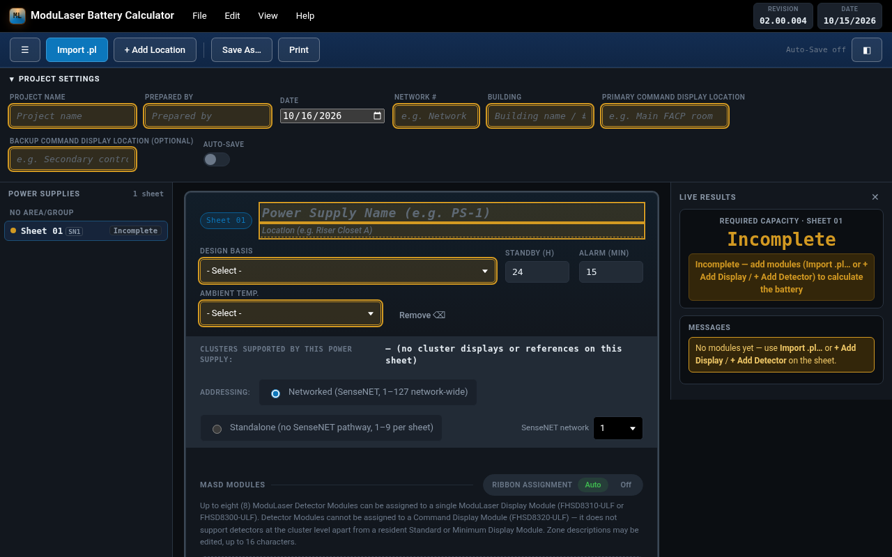

# ModuLaser Battery Calculator — Desktop App (Electron)




Wraps the calculator in a real desktop window for Windows and macOS, with
its own icon, taskbar/dock entry, and Start Menu / Applications shortcut.

## What's new in 02.02.000 (released 2026-10-19)

Edwards and Kidde Commercial brands, ASD-160 (Micra25 / Senator 25) support, AUX/ribbon rules (max 4 AUX per supply; max 4 detectors + 1 display per ribbon run), and a printable Quick Start (Help → Print Quick Start). See RELEASE_NOTES.md.

## What's new in 02.01.000 (released 2026-10-17)

- **MiniLaser ASD (FHSD8075-ULF) support (Brent 10-16).** Each sheet has a separate **Standalone ASDs** table: a MiniLaser is never addressed, isn't on SenseNET and can be on any sheet. Draw by fan speed 1–10: 120/134/157/180/200/230/255/285/320/365 mA (standby = alarm).
- **Dedicated AUX circuit per MiniLaser.** One MiniLaser per AUX circuit, never shared, with the 35 mA per-circuit overhead and 3.0 A per-circuit limit. When there are more MiniLasers plus entry points than AUX outputs, validation fails and recommends adding a power supply.
- **I/O Expansion Modules.** Choose 0–2 × 9-30521 per MiniLaser (no added draw). The 9-30520 housing is added automatically when the count is above 0, and the BOM lists both by part number.
- **+ Add MiniLaser.** Opens the Pre-engineered picker (T or I shape, manual Tables 13–31). It fills fan speed, alarm factor and DIP settings and shows pipe length, hole sizes and transport time. Choose Manual config for anything else; the fan speed starts blank, amber with ⚠, until you set it.
- **.pl import.** SOLO detectors become MiniLasers, with fan speed and alarm factor taken from the .pl. Expansions in the .pl are ignored, with a notice, and Confirm Settings? still runs. When the .pl has no alarm factor, the app uses the highest factor whose average hole sensitivity (Fire 1 × holes) stays within the class limit (VEWFD 1.0, EWFD 1.5, SFD 2.0, OAP 2.18 %obs/ft). If even 0 is over the limit, 0 is set and validation fails, recommending fewer holes or a redesign. Each MiniLaser gets a DIP or Remote configuration recommendation.
- MiniLasers appear on screen, in print, Word, Excel (CAD Schedule, no fills), the Cluster Validation Report and `.mlproj.json`. `modulaser-project.js` 1.5.1 and `masd-engine.js` 1.1.0; ModuLaser calculation math unchanged.

## What's new in 02.00.005 (released 2026-10-16)

Recent improvements (QA/Auditor PASS/GO on Calculator 57230cc; all suites green):
- **Auto addressing (Brent 10-16, revised 5:27 PM).** **New build** (first modules in an empty project — first .pl import or first + Add): **Networked or Standalone?** sets every sheet's mode, then **Auto address?** Yes / No. Yes numbers Networked sheets 1…N in sheet order across sheets (whole sheets roll to SenseNET 2 past 127, with the infrastructure notice) and Standalone sheets from 1 on each sheet. **Existing project** gaining modules (new .pl import, a new sheet, modules added to a sheet, Import Calc → Merge sheets): one prompt — **Continue addressing per previous sheets** (only the new modules; Networked continues after the last address on its network, a new sheet rolls to the next network past 127; a new Standalone sheet starts at 1), **Manually address**, or **Re-auto address entire project**. New sheets take the project's mode; mixed projects keep the Mixed addressing banner. After a .pl import: Confirm Settings? → (mode) → address; Revise import and linked-file re-imports don't prompt. Every automatic change is one **Edit → Address change log** entry with one-step Undo (Undo bar or Ctrl+Z). Quick repeated adds give one prompt, never stacked on another prompt.
- **Excel CAD Schedule shows standby, alarm and margin.** Each power supply table starts with a row with that sheet's own **Standby time** (h), **Alarm time** (min) and **Safety margin** (%). Still no merged cells or fills.
- **Cluster Validation Report print redesign (Brent approved).** KGS palette on white: navy title bar, project/network summary box, **Entry point** / **Ribbon Path** / **CALCULATION INVALID** / **VALIDATION ERROR PENDING** chips; every page repeats a header (CLUSTER VALIDATION REPORT · project · Network #) and footer (app name + revision · Page n of N); table headers repeat across pages, rows never split, cells don't wrap. On-screen report unchanged apart from the chips.
- **Incomplete shown in amber with ⚠ (Brent 10-16 6:07 PM).** Every Incomplete indication — sheet status (⚠ INCOMPLETE), an empty sheet's required Ah, battery and PSU recommendation, sidebar, Live Results, print stamps/tiles/tables and legend, Word cells, the withheld PSU recommendation and the CVR pending-validation chip — is amber with a warning symbol: needs-entry amber on screen (AA on the dark theme), #8a5a00 on #fdf3dc in print and Word (AA on white; the ⚠ and the word read in grayscale). Excel exports have no fills or colour coding at all (Brent 6:28 PM): there it's plain "⚠ Incomplete" text. `.mlproj.json` keeps the plain status for the Field Report.
- Calculation math, `masd-engine.js` 1.0.0 and `modulaser-project.js` 1.4.0 unchanged.

## What's new in 02.00.004
- **Valid defaults are no longer flagged.** Design Basis, Standby (h), Alarm (min), Ambient Temp., Module Type, Power, Addressing, supply mode, NFPA 72 edition and margin keep their defaults without amber and no longer make a sheet *Needs entry*. Only empty required fields (Power Supply Name, Location, module Address, Zone, Fan Speed…) are amber. **Edit → Confirm defaults** is kept but no longer needed (harmless).
- **New sheets start with no modules.** An empty sheet shows a guide: **Import .pl…** (from PipeCAD) or **+ Add Display / + Add Detector** (by hand). The last module can be removed (the guide returns). An empty sheet is *Needs entry* / INCOMPLETE.
- **Standby (h) / Alarm (min)** no longer cut values off on screens ≤ 1366 px (boxes keep 92 px; the settings row wraps).
- **Addressing per mode.** Networked sheets share an address pool per SenseNET network (1–127 on each network). A Standalone sheet is its own pool (1–9, now scoped per sheet instead of per cluster) and may reuse addresses from other sheets without a Validation Error; duplicates inside one Standalone sheet are still flagged.
- **Mixed Networked + Standalone** projects show a *Mixed addressing* banner: **Make all Networked…** / **Make all Standalone…**, confirm first, optional **Also re-address all modules** (Networked 1…N across sheets in order; Standalone 1…n per sheet; module order, ribbon/AUX/cluster assignments unchanged).
- **Imports keep addresses** (Import Calc, Import project, .pl re-import) and list any per-mode conflicts right after import.
- **SenseNET networks (up to 127 modules each).** Each Networked sheet has a SenseNET network number (selector on the Addressing row, SN1/SN2 tag in the sidebar, *Networked · SenseNET n* in print/Word/Excel settings, saved per sheet; older files default to network 1). Past 127 modules, whole sheets (last in sheet order first) move to SenseNET 2, 3… and are addressed from 1, and you're told a new network was added and the design must include its infrastructure. A sheet never spans networks. Duplicate addresses are checked per network. Networked re-address: 1–127 on SenseNET 1 in sheet order, then 1… on SenseNET 2. Imports keep networks; an import over 127 offers *Move overflow to a new SenseNET network*. Shared `modulaser-project.js` unchanged (the network rides in the calculator state inside `.mlproj.json`).
- **Address change log + Undo (QA F1/F2).** Unify / re-address, SenseNET network moves and Standalone clears are written to **Edit → Address change log…** (saved with the project and in `.mlproj.json` calculator state) with each module's address and network before and after, and can be undone in one step (Undo bar above the sheet, or Ctrl+Z outside text fields). Make all Standalone lists the addresses above 9 it will clear before you confirm and reports them afterwards; switching one sheet to Standalone does the same. Undo is disarmed by the next manual address/mode/network edit and Ctrl+Z is ignored while any field or dropdown has focus. Automatic SenseNET moves happen only when a network's count rises past 127; while a network is over 127 (e.g. after undoing a move) the flag stays and a **Move overflow to SenseNET n** banner offers the move. Clear file clears the address log.
- **Confirm Settings? after a .pl import (Brent 10-16).** After **Create sheets**, a prompt summarizes the settings applied during import (Design Basis, standby/alarm, ambient temperature, margin, edition, supply capacity/mode, files → sheets/modules). **Confirm** marks every item configured during the import as confirmed, so only genuinely empty fields (e.g. addresses) stay amber. **Revise import** rolls the import back and reopens the wizard on the review step with every choice kept. (Linked-file updates are unchanged.)
- **Design Basis and Ambient Temperature start on "- Select -".** It's an empty required selection: amber, and the sheet stays INCOMPLETE/Needs entry until chosen (no de-rating meanwhile, so no NaN). The .pl wizard requires both in step 1. Saved files keep their values; legacy files without these keys keep the old defaults (NFPA 72 Voice, 77 °F). Until a sheet has modules it shows **Incomplete** for battery Ah everywhere: results card, Live Results, sidebar, print, Word and Excel. In `.mlproj.json` the PSU has `requiredAh: null` and `incomplete: true`, with no battery and a blank PSU model/enclosure. There's no PASS and no battery/PSU recommendation. The Field Report imports it with Required Ah blank, and the shared modules are unchanged.
- Calculation math and `masd-engine.js` 1.0.0 unchanged (no engine bump). Shared `modulaser-project.js` 1.4.0 (bumped from 1.3.0 for SenseNET networks: each device in .mlproj.json carries its network, the shared validator checks duplicates per network and the 127 limit per network; byte-identical in the Calculator, Toolbox and Field Report 02.00.002).
- QA 2026-10-16: Calculator 951f769 / Toolbox 956e1e1 / Report de287fb GO (brief `qa/brief-02.00.004.md`).

## What's new in 02.00.003
- **Needs-entry fields are visible again.** A sheet marked *Needs entry* (amber dot) now outlines every field that needs entry in **amber** (2px), including the custom dropdowns. In 02.00.000–02.00.002 the old 1px soft-blue outline blended into the dark theme, so nothing appeared highlighted.
- **Show next ›** in the Live Results panel scrolls to and focuses each needs-entry field in turn.
- Print label grey darkened `#747574` → `#6b6c6b` for WCAG AA contrast.
- **Module table fits without truncation or wrap:** Module Type shows DISP-MIN / DISP-STD / DISP-CMD / DETECTOR, Cluster shows the 2-digit number (01), Power shows Own circuit or **Ribbon Path**. Print/Export and Word module tables add Model, Cluster and Power with the same labels.
- QA 2026-10-14 final: Calculator d34555b / Toolbox 209f54f GO.
- QA 2026-10-14: Calculator 43d5a23 / Toolbox 7d1cfec GO-conditional; Word header wrap fixed in final (see [RELEASE_NOTES.md](RELEASE_NOTES.md)).
- Already-saved .html files keep their own code; open them in 02.00.003 via **File → Import Calc** to get these fixes.
- Calculation math unchanged. QA brief: needs-entry 2026-10-14 (see [RELEASE_NOTES.md](RELEASE_NOTES.md)).

## What's new in 02.00.002
- **Shared MASD engine 1.0.0** (`masd-engine.js`) — byte-identical with the **MASD Engineering Toolbox 00.01.000**, which embeds this calculator; results unchanged.
- **Harmonization rule:** any engine change bumps the engine version and both apps' revisions with matching notes.
- Project file (`modulaser-project.js` 1.4.0, shared with the Commissioning Report and Toolbox): SHA-256 design/site hashes, pass-through of field changes, approvals, Toolbox config and Performance Criteria.
- QA audit 2026-10-13 ([issue #1](https://github.com/theBMGatKGS/ModuLaser-Battery-Calculator/issues/1)): see [RELEASE_NOTES.md](RELEASE_NOTES.md).

## What's new in 02.00.000

- **Web / PWA (live):** https://thebmgatkgs.github.io/ModuLaser-Battery-Calculator/ — open in a browser, or install it (Chrome/Edge install icon; iPhone/iPad Safari → Share → Add to Home Screen). Works offline after the first visit.
- **Windows installer:** [ModuLaser.Battery.Calculator.Setup.02.00.000.exe](https://github.com/theBMGatKGS/ModuLaser-Battery-Calculator/releases/download/v02.00.000/ModuLaser.Battery.Calculator.Setup.02.00.000.exe) — release [v02.00.000](https://github.com/theBMGatKGS/ModuLaser-Battery-Calculator/releases/tag/v02.00.000) (x64 NSIS, unsigned; SmartScreen may prompt).

Calculator revision **02.00.000_261013**. Major version 02.00 folds in the unreleased 01.06.000 work. **Calculation math is unchanged** — the same scenarios give identical Ah and BOM results to 01.05.009 (verified by the automated test suite).

### New layout
- **PipeCAD dark theme** on screen; printouts keep the KGS print palette.
- **Left sidebar** — power supply sheets grouped by Area/Group, each with a status dot (complete / needs entry / error / overridden), plus **+ Add power supply**.
- **Collapsible Project Settings bar** — one-line summary when collapsed; shows the Design Basis, standby/alarm and other sheet settings most sheets use, with an **override badge** on any sheet that differs (it is a summary, not a separate master setting).
- **Pinned live results panel** — required Ah vs the selected battery vs the 65 Ah limit, PASS / FAIL / INCOMPLETE, load breakdown, clusters and the sheet's validation messages.
- **Compact inline-edit module table** — every zone name has a live **n/16 character counter** (turns red over 16) and the ModuLaser 16-character display warning; the Zone column fits a full 16-character name and its counter.
- Panels collapse on narrow screens; the View menu toggles them.

### Menus and quick actions
- **File / Edit / View / Help** menu bar (keyboard accessible, white-on-black).
- **Quick-action row:** ☰ sidebar, Import .pl, + Add Location, Save As…, Print, Auto-Save indicator, ◧ results panel.

### PipeCAD .pl import wizard
1. **Battery settings first** (Design Basis, standby/alarm, temperature, battery) so every created sheet starts correct.
2. **Multi-file pick** — choose one or more `.pl` files, select which **Area/Groups** to import; metric drawings are converted to feet.
3. **Rename table** — name pattern with `{project} {file} {area} {name} {##}` (remembered), live **16-character display limit** counter, short-name suggestions and duplicate flags.
4. **Power supply assignment** — rules enforced: max **4 detectors + 1 display** per PSU; **≤ 65 Ah including the display**; one or more PSU per Area/Group; **no sharing across Area/Groups**. Seeded from **PSU positions in the file**, otherwise **3 ft plan-view clusters**; anything left goes to a per-Area/Group **Unassigned tray** (drag, Move to…, + Add power supply, or **Pack into fewest**). Create sheets stays blocked until the tray is empty.
- **Display `partNumber` mapping:** `0` = Standard Display (FHSD8310), `1` = Minimum Display (FHSD8300), `2` = Command Display (FHSD8320).

### Linked .pl tracking
- Each import saves the file name, size, date, SHA-256 and per-device fingerprints in the calc. **Check link** detects changes, shows a change banner and a diff, and **re-import** never changes addresses or hand edits without confirmation.

### Print / Export dialog
- File → Print / Export…, Print in the quick row, or **Ctrl+P**. One dialog with a **live 8.5 × 11 preview**, sheet scope, summary-page and BOM options, and **PDF**, **Word (.docx)**, **HTML** and **Excel** buttons — all built offline (no CDN). In the desktop app PDF is saved directly; in the browser it goes through the print dialog.
- **Detail levels: Summary / Standard / Full.**
- **Project summary page** — every PSU's Area/Group, required Ah, battery and PASS/FAIL.
- **One-page 8.5 × 11 PSU sheets** in the KGS palette: header, **capacity gauge** (required Ah, selected battery and 65 Ah marks, margin and de-rating shaded), **PASS/FAIL stamp**, **mini cluster diagram** (PSU with detectors and display), module table, settings and BOM.
- **Full-math appendix** pages per PSU: each step shows the **formula, substituted values, result with units and the code reference**.

### Excel export
- **CAD Schedule** tab — compact per-PSU tables (Zone, Type, Fan speed, Address, Standby mA, Alarm mA, footer with Ah / battery / PASS), thin borders, fixed widths, no merged cells or fills, for **copy/paste directly onto 2D CAD drawings**.
- **Detail** tab — follows the chosen detail level with **outline row grouping** (expand/collapse per PSU and per step).

### Help
- **Help, Quick Start, How Do I…, FAQ, tooltips and the Revision Log** fully rewritten for 02.00.000 — new layout, .pl import, Print / Export, detail levels and the CAD paste tip.

### Recent improvements (01.05)
- Dropdown scroll + keyboard navigation (01.05.009)
- Sheet header layout: PS Name/Location on its own row; wider Design Basis (01.05.008)
- White-on-black custom dropdowns (01.05.007)
- Import Calc (replace/merge), Clear (sheet or file), Confirm defaults (no longer needed since 02.00.004), needs-entry highlighting (amber since 02.00.003; empty required fields only since 02.00.004)
- Searchable How Do I… help

Full history: [`CHANGELOG.md`](CHANGELOG.md) and Help → Revision Log in the app.

## One-time setup

1. Install [Node.js](https://nodejs.org) (LTS version) if you don't have it.
2. Open a terminal in this folder and run:
   ```
   npm install
   ```

## Try it without building anything

```
npm start
```
Opens the calculator in an Electron window right away — good for checking
everything works before you build an installer.

## Build an installer

```
npm run build:win     # → dist/ModuLaser.Battery.Calculator.Setup.02.02.000.exe
npm run build:mac     # → dist/ModuLaser.Battery.Calculator.Setup.02.02.000.dmg
npm run build:all     # both, if your machine can build both (see note below)
```

### Important: macOS builds need to run on a Mac

`electron-builder` can build a **Windows** installer from Windows, macOS, or
Linux. But it can **only build a macOS app/.dmg while running on macOS** —
Apple's code-signing tools don't exist anywhere else. So:

- Building on **Windows**: `npm run build:win` works directly.
  `npm run build:mac` will fail — you'd need a Mac (or a free CI service
  like GitHub Actions with a `macos-latest` runner) to produce the .dmg.
- Building on a **Mac**: both `build:win` and `build:mac` work directly.

If you don't have access to a Mac, the easiest free route is a GitHub
Actions workflow that checks out this folder and runs `npm run build:mac`
on a `macos-latest` runner — happy to help set that up if you want it.

## About menu

The app has a Help → About menu item (and on macOS, the standard app menu's
"About ModuLaser Battery Calculator" too) showing the revision and author —
currently Revision `02.02.000_261019`, authored by The BMG. These are set
as constants at the top of `main.js` (`APP_REVISION`, `APP_AUTHOR`) —
update them there whenever you cut a new revision, and keep them matching
the calculator's own title-bar Revision/Date cells and its "About" section
in the Help overlay, so all three deliverables stay consistent.

GitHub releases use the same number as the calculator revision: tag/title
`v02.00.000` for calculator `02.00.000` (the `_YYMMDD` date stays in-app /
`package.json` `revision` only). The npm/`electron-builder` `version` field
stays plain semver without leading zeros (e.g. `1.5.7`) so NSIS accepts it;
installer filenames are forced to `…Setup.02.00.000.exe` via `artifactName`.

### Revision numbering scheme

Format: `MM.mm.rrr_YYMMDD`
- `MM` (major) and `mm` (minor) are set manually — never auto-changed.
- `rrr` is a 3-digit counter, incremented by 1 for each distinct logical
  change made in a chat session, reset to `000` only when `mm` is next
  revised manually.
- `YYMMDD` is the actual calendar date of that change.
- GitHub release tag: `vMM.mm.rrr` (matches the calculator revision;
  supersedes the older separate `v1.0.x` desktop numbering).

The full running changelog lives in the `AMENDMENTS` array inside
`app/modulaser_battery_calculator.html` (near the top of the `<script>`
block) — that's the source of truth; the Electron About dialog just shows
the latest revision and points here for the complete history.

## Updating the calculator itself

Replace `app/modulaser_battery_calculator.html` with the newer version
whenever you get an updated export, then rebuild.

## iOS

Electron cannot produce an iOS app — it's a desktop-only technology
(Windows/macOS/Linux). For iOS, use the PWA version of this calculator
instead: host it (even a free static host like GitHub Pages or Netlify
works), then on the iPhone open it in Safari and use
Share → "Add to Home Screen." That gives a real home-screen icon and a
standalone app-like window, with offline support via the service worker
already built into the PWA package. A true native iOS app (App Store or
sideloaded) would require Xcode, a paid $99/year Apple Developer account,
and a substantially different build — not something this Electron setup
can produce.

## Folder contents

- `main.js` — Electron entry point, opens the calculator in a window
- `app/modulaser_battery_calculator.html` — the calculator itself
- `build/icon.ico` / `icon.icns` / `icon.png` — app icons for Windows/macOS/Linux
- `package.json` — dependencies + electron-builder configuration
